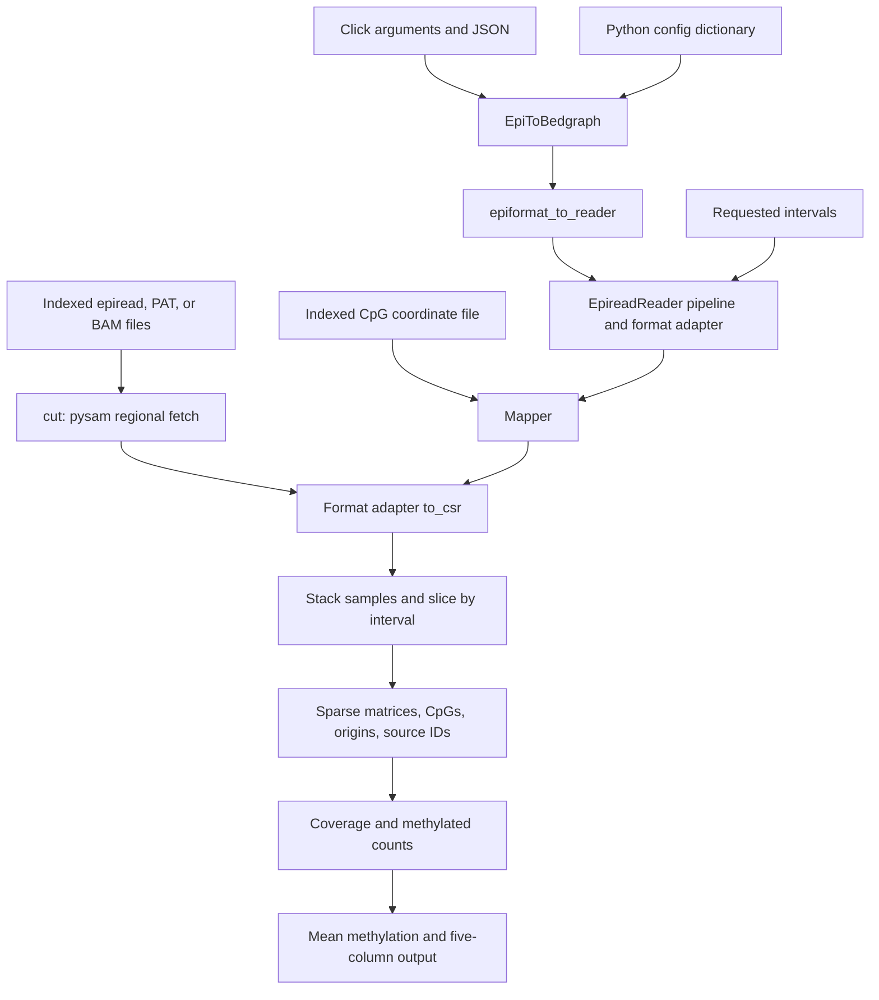

# Current architecture

Reviewed 2026-09-16 against source commit
`7a6a6b397b5e8d3a0c18575dbe65a7e45a7bbed6` on `ben-bam-support`.
This describes observed implementation, including known inconsistencies.
Functional tests have not been run in this environment; see [plans.md](plans.md).

## Purpose and boundaries

`epiread_tools` is a setuptools Python package, version `0.0.3`. Its main path
converts indexed methylation records into SciPy sparse matrices and per-CpG
methylation/coverage output. It also exposes atlas and SNP utilities for other
programs. The deconvolution models themselves are external and absent here.

There is one installed console command, `epireadToBedgraph`, mapped to
`epiread_tools.epireadToBedgraph:main`. There is no service, database, scheduler,
or repository CI configuration. `__init__.py` is empty; consumers import modules
and classes directly.

## Source and supporting files

| Path | Responsibility |
| --- | --- |
| [epireadToBedgraph.py](../epiread_tools/epireadToBedgraph.py) | Click CLI, configuration assembly, `EpiToBedgraph` orchestration, five-column output. |
| [epiformat.py](../epiread_tools/epiformat.py) | Registry mapping four format names to reader classes. |
| [epiparser.py](../epiread_tools/epiparser.py) | Shared reader pipeline; epiread, coordinate, PAT, SNP, and atlas classes; row decoders. |
| [ModbamReader.py](../epiread_tools/ModbamReader.py) | Modified-base BAM adapter, quality classification, coordinate mapping. |
| [em_utils.py](../epiread_tools/em_utils.py) | Intervals, indexed fetching, CpG/SNP mapping, interval merging, coverage/methylation utilities. |
| [naming_conventions.py](../epiread_tools/naming_conventions.py) | Integer encodings, separators, strand labels, chromosome labels, and shared constants. |
| [setup.py](../setup.py) | Package metadata, unpinned dependencies, console entry point. |
| [Dockerfile](../Dockerfile) | Python 3.11 build/runtime image and integration with external deconvolution code. |
| [join_lambdas_thetas.pl](../ben_scripts/join_lambdas_thetas.pl) | Independent Perl join of lambda/theta tables, means, and minimum-value separation statistic. |
| [tests/](../tests/) | Six pytest tests, JSON examples, and small indexed fixtures. |
| [sample_config.json](../epiread_tools/sample_config.json) | Legacy example; currently invalid JSON and references absent fixtures. |
| [dist/](../dist/) | Seven tracked historical distributions, versions 0.0.1–0.0.3; none contains `ModbamReader`. |
| [.idea/](../.idea/) | Tracked IDE settings; Python 3.7 label is historical, not a tested runtime requirement. |

## Main data flow

1. `EpiToBedgraph` selects a reader from the format registry.
2. `EpireadReader` groups intervals by chromosome, preserving first-seen
   chromosome order, and sorts each chromosome's intervals by start.
3. `Mapper` loads CpGs around merged, expanded intervals; builds absolute,
   relative, and matrix-column maps; initializes sample IDs and SNP maps.
4. Each registered adapter's `to_csr(file, mapper)` returns a sparse matrix and origins, or
   `(None, None)` when no entries were collected. Matrices from files are stacked.
5. The shared reader slices by requested interval, eliminates explicit zeros,
   and filters rows by the number of nonzero CpGs. A chromosome with no collected
   matrix is omitted; an empty interval slice within a processed chromosome gets
   a single all-zero row and `-1` origin/source sentinels.
6. `get_matrices_for_intervals()` returns parallel lists:
   `(interval_order, matrices, cpgs, origins)`. Source IDs are available separately
   through `get_sources()`. Normal sample IDs start at 1; `All` is 0.
7. `EpiToBedgraph.tobedgraph()` calculates coverage, methylated counts, their
   ratio, and writes rows with positive coverage.

The intended matrix contract is rows = reads, columns = CpGs, values = encoded
states. **The current BAM adapter instead allocates a row per recorded
modification**, which affects read-level filtering and downstream algorithms.

## Reader formats and encodings

| Registry value | Reader | Record interpretation |
| --- | --- | --- |
| `old_epiread` | `EpireadReader` / `EpiRow` | Chromosome, min/max coordinates, read metadata, first CpG coordinate, retention pattern, optional SNP fields and origin. Pattern positions advance through the CpG map. |
| `old_epiread_A` | `CoordsEpiread` / `CoordsRow` | Same broad record shape, with explicit comma-separated CpG coordinates paired with pattern characters. |
| `pat` | `PatReader` / `PatRow` | Chromosome, starting pattern coordinate, pattern, count, optional origin; repeated observations are expanded into rows. Fixtures use a matching coordinate space in the PAT CpG file. |
| `modbam` | `ModbamReader` | Indexed BAM via `pysam.AlignmentFile`; modification annotations and query-to-reference position mapping. |

Methylation encodings are `NOVAL=0`, `UNMETHYLATED=1`, and `METHYLATED=2`.
`C/c` maps to 2; `T/t` to 1; `.`, `N/n`, and `-` to 0. Coverage counts only values
equal to 1 or 2; methylated counts include only 2. Sparse absence represents 0.
DNA/SNP codes use a separate mapping: A, C, T, G, R, Y map to 1 through 6.

`EpiSNP` and `CommentEpiSNP` are not in the format registry. They use SNP-specific
row parsing and `Mapper`'s padded SNP coordinate space. Their `to_csr()` returns
only a matrix, unlike the pair expected by the inherited main pipeline; their
end-to-end use is not established by the tests.

## Coordinate and input contracts

- `GenomicInterval` stores integer start/end values verbatim from strings or BED
  fields; length is `end - start`. `slop()` clamps the start to zero but does not
  clamp the end to a chromosome length.
- `cut()` fetches both Tabix and BAM records with `(chrom, start - 1, end)`.
  It catches `ValueError` as no coverage. A zero start or chromosome mismatch can
  therefore be misreported as empty coverage rather than clearly diagnosed.
- `Mapper` uses the second CpG-file column directly. Its interval lookup uses
  `bisect_left(start)` and `bisect_right(end)`, including a CpG at the end bound.
  `in_intervals()` instead tests strict interior membership. Do not assume one
  uniform half-open convention throughout this branch.
- Tabix-backed inputs need compatible compressed data and indexes. BAM opening
  explicitly requires an index. `tabix_verify()` checks file/index existence and
  the `.gz` suffix, but the main pipeline does not invoke it automatically.
- Coordinate lists must be sorted for bisection. The pipeline sorts requested
  intervals before merging; `merge_win_list()` itself expects ordered, nonempty input.
- `bedgraph_to_intervals()` and the methylation/coverage atlas loader remove
  chromosome names containing `alt`. This is implemented filtering, not an
  assembly validation mechanism. The chromosome constant is not an enforced filter.
- The code does not validate reference assembly compatibility. BAM fixture names
  identify hg38 and their headers contain `chr16` length 90,338,345. The older
  epiread/PAT fixtures do not explicitly establish an assembly here; PAT positions
  must not be assumed to be genomic base coordinates from their numeric values alone.

## Configuration and defaults

The Python API takes a dictionary. For the basic reader path it needs
`epiformat`, `epiread_files` (list of paths), `cpg_coordinates`, `genomic_intervals`,
and `bedfile`. If `bedfile` is false, intervals are a list of `chr:start-end`
strings; otherwise they are a path and `header` is required. Writing also needs
`outfile`. Even the BAM reader currently requires the CpG coordinate file.

| Setting | Current value or behavior |
| --- | --- |
| `minimal_cpg_per_read` | Defaults to 1; applied to nonzero calls within each interval. |
| Base/coordinate-reader mapper slop | 1,500. |
| PAT mapper / fetch slop | 100 / 20, with fetch expansion on both sides. |
| BAM mapper slop | 500. |
| Atlas mapper slop | 1. |
| `Mapper` standalone defaults | Slop 800; minimum merge distance 0; SNP padding 2,000. |
| BAM quality classification | Quality >170 becomes methylated; <86 becomes unmethylated; 86–170 becomes unknown. |
| `calc_percent_U()` | Unmethylated-read threshold 0.25; does not filter empty/short rows itself. |

The CLI accepts JSON, explicit Click options, and extra `--key=value` pairs.
Observed merge order is initial config, Click values, extra pairs, then JSON;
JSON wins. Extra-pair values remain strings. The initial `old_epiread` default
can be overwritten by Click's `None` value. Current parsing also calls `.split()`
on a JSON list of epiread paths and reads `config['intervals']` while the declared
option is `genomic_intervals`. `modbam` is present in the Python registry but
absent from Click's format choices. The CLI and README should not be treated as
a verified interface until these problems are addressed.

## BAM implementation details

`ModbamReader` inspects `modified_bases`, maps positions through
`get_reference_positions(full_length=True)`, skips reference positions that are
`None`, and subtracts one from positions whose modification-key strand is reverse.
It iterates all modification types without selecting a canonical base or
modification code. It does not add read-flag or mapping-quality filters.

The adapter increments `row_ind` for every stored modification and returns an
extra trailing row plus zero-filled origins. The shared reader removes empty
rows for nonempty interval slices. `if rel` drops the first mapped CpG (relative
index zero). A quality value of `-1` would enter the unmethylated branch. Reads
without modification annotations contribute no calls. Processing counters are
class variables that accumulate across reader instances. These details need
focused validation before claiming complete modified-base or read-level support.

## Output and atlas interfaces

The output named “bedgraph” contains **five** tab-separated columns with no
header: chromosome, CpG coordinate, coordinate + 1, mean methylation, coverage.
There is no interval identifier; overlapping requested intervals can repeat
positions. With no output rows, the writer only prints a message and does not
create or truncate the destination, so an existing output can remain stale.

`AtlasReader` consumes a headered table with chromosome/start/end columns and
alternating methylated-count/coverage columns per cell type. It aligns dense
cell-type-by-CpG matrices to `Mapper`, computes beta values, and returns either
per-CpG matrices or interval sums. Unmatched positions remain NaN; the local
coordinate mismatch exception has been disabled. Zero coverage is not explicitly
guarded in the beta division.

`EpiAtlasReader` reads lambda columns from column 7 onward after skipping a header;
theta input has eight named columns, including two list-valued columns parsed
with `eval()`. It must not be treated as a safe parser for untrusted text.
`UXMAtlasReader` reads intervals from the first three columns and percent-U values
from column 7 onward; its source comments exclude overlapping-region/walker use.

The standalone Perl script joins tables on the first three fields, calculates
means for theta list columns 7/8, and reports the smallest and second distinct
smallest lambda values with their difference. Missing keys stop execution. It
does not call the Python package and has no automated functional test here.

## Packaging, environment, and validation surface

`setup.py` declares unpinned NumPy, pandas, SciPy, pysam, pytest, and Click;
there is no `python_requires`, lockfile, or requirements file on this historical
branch. The Dockerfile uses Python 3.11 Bullseye in both stages, installs through
`setup.py`, and expects `deconvolution_models/` plus its demo data in the build
context. That directory is absent and ignored. The runtime uses an `appuser`
account and development `PYTHONPATH` locations; no entry point is active.

Existing tests cover interval intersection; matrix shapes for two epiread
formats; repeated-interval coverage; one PAT coverage value; and total BAM
coverage of four calls in each of two intervals. They instantiate the Python API,
not the CLI, and do not validate written output, BAM read grouping, quality
thresholds, coordinate boundaries, atlas parsing, or SNP reader integration.

The active BAM/SAM fixtures contain two alignments; the unused pair adds
insertions. The active CpG fixture contains 273 rows and the unused coordinate
variant is shifted by one base. Preserve these distinctions. Package archives
are historical outputs, not the source of truth for this branch's BAM behavior.

See [plans.md](plans.md) for measured validation, known issues, and proposed work.
